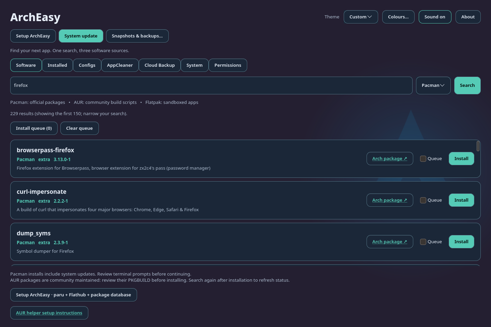
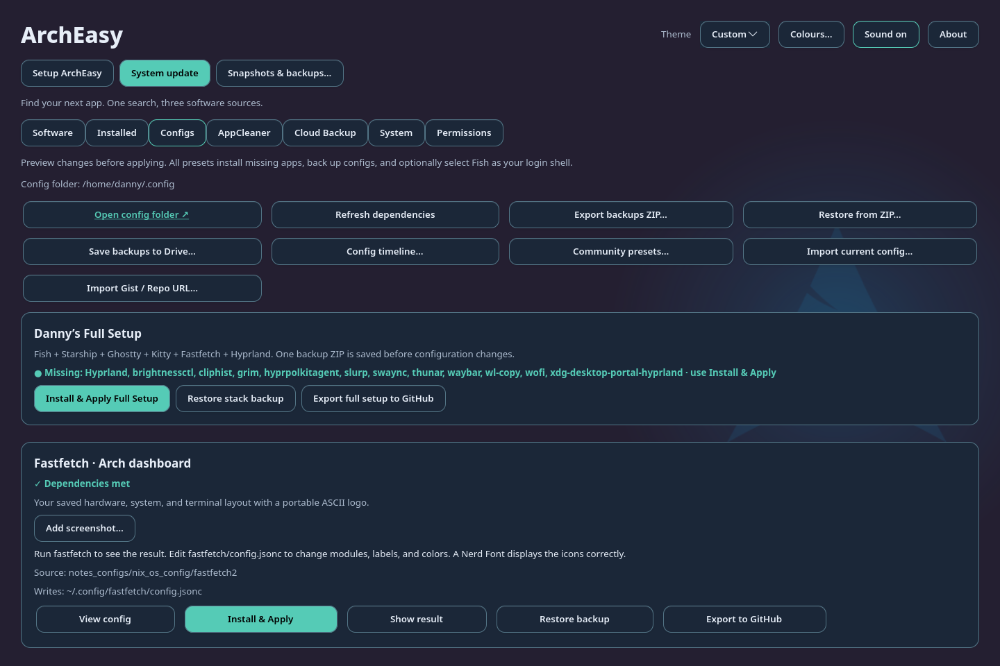
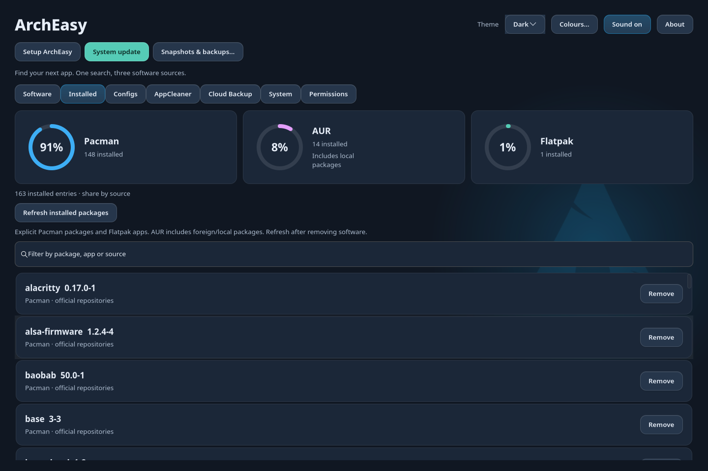

# ArchEasy

A Rust + GTK4 software browser for Arch Linux. Search Pacman, AUR, Flatpak, and GitHub together, filter by source, see installed packages, and start installation from a package card.

## Screenshots

Store (the **Software** tab), searching official packages:



Configs, with built-in presets and backup controls:



Installed software, with animated percentage circles by source:



## Install

### Binary release

Download the `x86_64` archive and its SHA-256 file from [GitHub Releases](https://github.com/danny19862025/ArchEasy/releases). Built on Arch Linux for Arch Linux; GTK4 4.10+ and Libadwaita 1.2+ are required and are not bundled.

```sh
sha256sum -c archeasy-0.1.2-x86_64-linux.tar.gz.sha256
tar -xzf archeasy-0.1.2-x86_64-linux.tar.gz
cd archeasy-0.1.2-x86_64-linux
install -Dm755 archeasy "$HOME/.local/bin/archeasy"
bash scripts/install-desktop.sh
```

Ensure `~/.local/bin` is on your desktop session's `PATH`.

### Build and install with Cargo

```sh
git clone https://github.com/danny19862025/ArchEasy.git
cd ArchEasy
cargo install --path . --locked
bash scripts/install-desktop.sh
```

Cargo installs the executable only. The helper installs the launcher and icon under `$XDG_DATA_HOME` (default `~/.local/share`). Ensure `~/.cargo/bin` is on your desktop session's `PATH`.

### Arch package / AUR recipe

The VCS recipe is [scripts/PKGBUILD](scripts/PKGBUILD). Build it as your normal user in a separate folder:

```sh
mkdir -p /tmp/archeasy-package
cp scripts/PKGBUILD /tmp/archeasy-package/
cd /tmp/archeasy-package
makepkg -si
```

This installs the binary, desktop launcher, icon and licenses. `paru -S archeasy-git` will work once a maintainer submits this recipe to the AUR; adding a PKGBUILD to GitHub does not register an AUR package.

## Guides

- [Backups, cloud storage and transfer](docs/backups.md)
- [Config presets, sharing, history and community sources](docs/configs.md)
- [Development, tests and releases](docs/development.md)

## Appearance

The top bar includes **About** (app version and installation information) and a **Theme** selector: System, Light, Dark, or Custom. Theme changes apply immediately and are saved in `$XDG_CONFIG_HOME/archeasy/theme` (normally `~/.config/archeasy/theme`). System uses your desktop’s GTK appearance. Missing, unreadable or corrupt theme preferences fall back to System, including a Custom selection whose palette is missing or invalid. The **Colours…** button beside Theme opens **Customize ArchEasy theme**. Choose background, surface, text, secondary text, accent, and border colours using colour pickers or #RRGGBB values. **Apply theme** saves and selects Custom; **Cancel** leaves the saved theme unchanged. **Reset colours** stages the default palette until you apply it. Custom colours are saved in `~/.config/archeasy/custom-theme.json` (under `$XDG_CONFIG_HOME` when set).

The app background includes the Arch logo with a subtle blue halo. Buttons have rounded styling, hover glow, visible keyboard focus, and pressed feedback. **Sound on / Muted** toggles the short click sound and saves the preference in `~/.config/archeasy/sound` (or `$XDG_CONFIG_HOME/archeasy/sound`). Sound playback uses PipeWire `pw-play`, PulseAudio `paplay`, or ALSA `aplay`, whichever is available, and runs outside the UI thread.

## Run

On opening, the Arch logo scales and fades in with blue light rings and the ArchEasy wordmark, then reveals the app after 1.8 seconds. Click or press Escape to skip. The intro is omitted when desktop GTK animations are disabled.

```sh
cargo run --release
```

Requires GTK4 (4.10+), Libadwaita (1.2+), Rust, pacman, curl, and a supported terminal (Ghostty, foot, Alacritty, WezTerm, Konsole, Kitty, GNOME Terminal, Xfce Terminal, or xterm). Flatpak search requires Flatpak and configured remotes. **Setup ArchEasy** upgrades Arch and refreshes its package database, installs Flatpak/build tools/Python, builds paru if missing as your desktop user after PKGBUILD review, and adds Flathub for your account. Requires sudo access and a working Arch mirror configuration. [Paru installation](https://github.com/Morganamilo/paru#installation), [Flatpak remotes](https://docs.flatpak.org/en/latest/using-flatpak.html).

The Install button opens an interactive terminal. Official-package installs first ask “This will upgrade your whole system”; Cancel starts no transaction. Passwords, transaction confirmation, dependency choices, and AUR build review remain in the package manager. Pacman uses `sudo pacman -Syu --needed` so installation can also update the system. Flatpak installation uses your user account. Each result has a link beside Install: **Arch package** opens the official Arch package listing filtered to that exact package name, **AUR page** opens its AUR page and build files, and Flathub results have a **Flathub page** link. Links remain available for installed packages. Close an installation terminal only after its transaction finishes. Search again afterward to refresh installed status.

Search errors appear above the results. Install errors appear in a dialog. If a terminal crashes immediately, ArchEasy tries another supported terminal and reports startup failures. After a launch failure, search again to retry. Pacman searches the locally synchronized database; AUR searches the online RPC API; Flatpak searches configured AppStream catalogs. Results are limited to 150 cards; use a more specific search for large result sets. No automatic package installation or removal occurs on app startup.

## GitHub builds

The GitHub logo selects GitHub search; **danny19862025** beside it opens Danny’s repositories. ArchEasy is suggested first only for relevant queries such as `archeasy`, `easyarch`, or `danny19862025`. Unrelated searches show their own matches. Other results retain their verified **Clone & Build** action.

The **GitHub** source searches the GitHub repository API with your query plus `PKGBUILD in:name,description,readme`. It checks the first 20 candidates for a root PKGBUILD and displays matching repositories with their description, star count, and GitHub page link. Repository search uses metadata, so repositories that never mention PKGBUILD may not be discovered; nested build recipes are excluded. Search results are cached for five minutes. GitHub results also appear under **All**; installed packages remain tracked by Pacman/AUR or Flatpak.

**Clone & Build** opens the usual interactive terminal, clones into a fresh private `/tmp/archeasy-github-<owner>-<repo>.*` workspace, displays PKGBUILD for review, and runs `makepkg -si` after confirmation. Git and the `base-devel` build tools are required. The workspace remains available for inspection or another build. GitHub builds run individually and are not included in the package queue.

Optionally save a GitHub token in `$XDG_CONFIG_HOME/archeasy/github_token` (default `~/.config/archeasy/github_token`) with permissions `0600`. Public repository search works without a token; GitHub applies separate search and API request limits, and each candidate check uses an API request. Rate limit and authentication failures appear in the search status. Tokens are sent only to the GitHub API and are never passed to terminal commands. Release binary/AppImage installation is not included in this source.

## System updates

The top-bar **System update** button first offers a Timeshift or Snapper snapshot when installed, or an update without a snapshot. Configure the snapshot tool beforehand; Snapper uses its `root` configuration. A requested snapshot failure stops the update. The terminal then runs:

1. `sudo pacman -Syu` for official packages.
2. `paru -Sua` or `yay -Sua` for AUR packages only.
3. `flatpak update --user` for your account.
4. `flatpak update --system` for the default system-wide Flatpak installation.

Review the usual password, package, and build prompts in that terminal. No confirmations are bypassed. If Pacman fails or is cancelled, AUR is skipped; Flatpak steps still run independently. Missing tools, failed commands, and skipped steps appear in the final summary. A per-user lock prevents duplicate ArchEasy update sessions. Keep the terminal open until package operations finish; it waits at the summary so you can read it. Nothing updates automatically on app startup.

## AppCleaner

The **AppCleaner** tab beside **Configs** includes the standalone AppCleaner's functions: installed application discovery and search, background scans of matching settings/cache/data folders, folder sizes and partial-scan indicators, individual folder selection, a confirmation listing exact paths, and moving selected items to the desktop Trash. Restore items through your file manager's Trash. **Run in terminal** executes the displayed uninstall command with normal password and package-manager confirmation prompts. The command remains visible and can still be copied. Only supported, validated uninstall commands can run; file cleanup stays separate from package removal.

AppCleaner follows ArchEasy’s **System, Light, Dark, or Custom** appearance immediately. Its sidebar and controls use the shared GTK colours, and **Colours…** edits the one custom palette for the whole app. AppCleaner has no separate theme selector or palette; old standalone/embedded AppCleaner theme preferences are ignored.

Discovery starts on first opening the tab. Matches use exact desktop IDs/names; shared folders, top-level symlinks, and folders outside your home roots are excluded. Nothing is selected automatically. Close the target app and review paths before cleanup. Trash failures are reported without permanent deletion.

The embedded AppCleaner code's MIT license is included in `assets/AppCleaner-LICENSE`.

## Store queue and installed packages

Tick **Queue** beside search results, including results from different searches, then **Install queue**. One terminal installs packages in the selected order and stops on failure. Earlier completed installs are kept. Pacman refreshes and upgrades the system with the first official package; subsequent official packages use the refreshed database. AUR packages use paru/yay and retain build review prompts. **Clear queue** clears selections; tick a result again to re-add it.

The **Installed** tab shows three percentage circles for **Pacman**, **AUR**, and **Flatpak**, with installed counts. The circles pop into view in sequence and fill/count up when the tab opens or you refresh; they respect the desktop’s reduced-motion setting. Percentages use the full list, regardless of the search filter, and round to 100% when entries exist. The list includes explicitly installed native/foreign Pacman packages and user/system Flatpak apps (separate installations count separately; Flatpak runtimes and Pacman dependency-only packages are excluded). AUR includes locally built/foreign packages, which Pacman cannot distinguish from AUR builds. If a source query fails, known entries remain visible and percentages show as unavailable until a successful refresh. Filter by app, package or source. **Remove** opens `sudo pacman -R` or the matching user/system `flatpak uninstall` command with normal confirmation prompts. Refresh after a transaction to update the list.

## System helpers

The **System** tab detects the running kernel, installed linux/linux-zen/linux-lts/linux-hardened packages, GPU PCI information and known NVIDIA driver packages. It distinguishes DKMS from kernel-specific drivers and checks matching headers for detected DKMS setups. Warnings link to the Arch driver guide; no kernel, driver or boot configuration changes automatically. PCI detection needs `pciutils`.

The **Permissions** tab lists user and system Flatpaks. Choose an app, select **Override** for a permission, and use its allow/deny switch. Only selected per-user overrides are changed. The screen shows app permissions and all system/user override layers. Audio access covers speakers and microphone together; devices access includes cameras. Folder permissions can overlap, and portals retain separate permissions. Restart the app after applying. A **Permissions** button is also available on Flatpak search results; refresh the Permissions tab after installation.

Task-based search uses the local `data/search-keywords.json` mapping. For example, “video editor like Premiere” searches Kdenlive, Shotcut and DaVinci Resolve across the selected package sources. It uses no AI service and sends only mapped search terms to the normal package search sources.

**Export my system · setup-my-pc.sh…** in **System** saves a private executable script containing explicit official packages, explicit foreign/AUR packages, user/system Flatpak apps and HTTPS remotes, plus the current files known to ArchEasy's config history. You can publish the applied configs through the existing review dialog and include the resulting Gist URL. Configs are also bundled directly, so the script does not depend on a live Gist. Review the exported file for private config contents. Running it prompts before installation, bootstraps a reviewed paru build if needed, and backs up destination configs before restoring; linked destinations require manual review. This reproduces package/config selections using current repositories, not exact versions, disks, personal files, boot settings or external credentials. Foreign packages unavailable in the AUR need their original installation source.

## Config safety and everyday tools

- **Show what will change** opens a read-only dry run for built-in and imported presets, including Full Setup. It creates no backups or config files and offers no Apply action. **Config timeline…** lists dated versions and previews the diff before restoring.
- Applies touching Fish scripts syntax-check each changed `.fish` file and run `fish -c "echo ok"` with the updated config in a background task. Each check times out after ten seconds. Failure automatically restores the whole transaction, including original file modes and symlinks, reports the backup location and shows a toast. Fish must be installed to validate Fish presets; Install & Apply can install it first. Other config commands and arbitrary startup side effects are outside the file rollback.
- **About** shows the Cargo version, project GitHub link and **Check for updates**. The check requests the latest stable GitHub release only when clicked and opens download links without installing updates.
- The last five completed searches are saved privately and appear as reusable chips below the search bar. Repeated searches move to the front.
- The gear beside **Sound on / Muted** opens a saved 0–100% click-volume slider, including preview. Muting and zero volume stay silent.
- **System → Find orphans** inspects `pacman -Qdt`. Select packages and review removal in the terminal; orphan status is rechecked immediately before `sudo pacman -Rs`, which asks for final transaction confirmation and retains Pacman's normal config-backup behaviour.
- **Clean Pacman cache…** shows `/var/cache/pacman/pkg` size and uses `paccache --remove --keep 3` after confirmation, retaining the newest three cached versions of each package. Requires `pacman-contrib`; use Refresh after cleaning.

References: [Timeshift commands](https://man.archlinux.org/man/timeshift.1.en), [Snapper snapshots](https://man.archlinux.org/man/snapper.8.en), [Flatpak overrides](https://docs.flatpak.org/en/latest/flatpak-command-reference.html#flatpak-override), [NVIDIA driver selection](https://wiki.archlinux.org/title/NVIDIA), [Catppuccin Kitty themes](https://github.com/catppuccin/kitty).


Terminal selection honours `$TERMINAL` first, then `xdg-terminal-exec`, then the supported terminals above. Quoted arguments in `$TERMINAL` are parsed into arguments without shell evaluation.

Installed-package removal defaults to `pacman -R`. The optional **-Rns** checkbox also removes unneeded dependencies and disables Pacman’s `.pacsave` preservation of modified package configs. The terminal still asks for transaction confirmation.
